<h1 align="center">Hi, I'm Amine Hümanur</h1>
<h3 align="center">Computer & Instructional Technologies graduate, building code at 42 Kocaeli</h3>

  

<h3 align="left">Connect with me:</h3>

<h3 align="left">Languages and Tools:</h3>

  

<picture>
  <source media="(prefers-color-scheme: dark)" srcset="https://raw.githubusercontent.com/humanur/humanur/pacman/pacman-contribution-graph-dark.svg" />
  
</picture>
